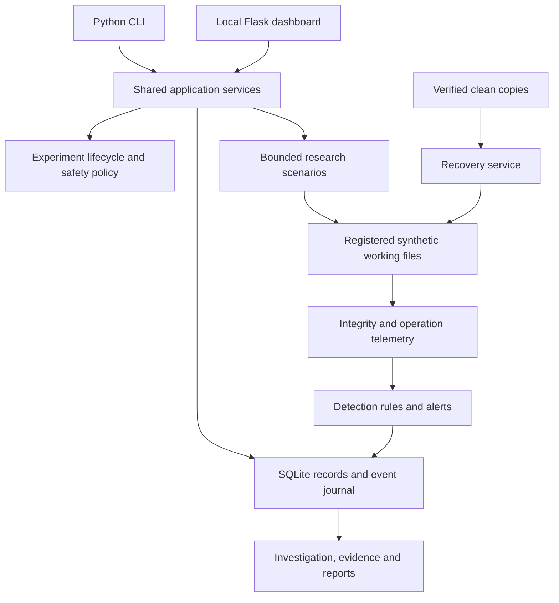

# Antech-RansomLab

A Python research laboratory for studying ransomware behaviour, detection,
investigation, and recovery using generated disposable data.

**Status: Phase 0 architecture review.** This repository already contains a
development implementation; Phase 0 audits and preserves it. Existing code is
not acceptance of later phases. Native filesystem validation remains incomplete,
and the full research platform described below is a proposed target.

The repository remains [Antech-greyhat/RansomLab](https://github.com/Antech-greyhat/RansomLab).
On 2026-11-11 the owner explicitly authorized keeping it public and pushing the
Phase 0 documentation. This exception does not authorize a release, deployment,
or work on Phase 1 before Phase 0 review and merge.

[Getting started](#getting-started) · [Research workflow](#research-workflow) ·
[Scenarios](#research-scenarios) · [Tests](#tests) · [Roadmap](#roadmap-and-contributions)

## Purpose and research outcomes

Antech-RansomLab studies observable incident stages and the controls that limit
their consequences. It is intended for researchers and defensive training, not
production endpoint protection, real malware execution, or recovery of victim data.

A completed experiment should establish how the simulated incident began, what
changed, which controls detected it, what synthetic data was staged or exposed
to the mock destination, how activity was contained, and whether recovery matched
the original baseline. Findings must cite actual events and evidence. Undetected
activity, incomplete telemetry, and failed recovery must remain visible.

Initial access is represented by an explicit local scenario start, not phishing,
exploitation, credentials, or remote execution. Prevention research compares
bounded controls such as authorization, quotas, canaries, and backup separation;
it never disables host security software.

## Existing implementation and gaps

| Capability | Audited implementation | Remaining target work |
| --- | --- | --- |
| Core | Immutable policy, UUID identifiers, SQLite events/state, shared `LabService` | Typed experiments, explicit validation/closure, schema migration contract |
| Cryptography | SHA-256, byte-only AES-256-GCM through Windows CNG; optional non-Windows adapter | Reviewed portable provider, asymmetric/signature demonstrations, persisted measurements |
| Simulation | `encrypt_generated` and `modify_generated`, expiring requests and local arming | Six research scenarios, repeatable configuration, discovery, staging, mock transfer |
| Monitoring/detection | Inventory hashing and changed/missing counts | Canaries, rename observations, health/loss records, time-window rules and evaluation |
| Forensics/recovery | Evidence manifests, timeline exports, clean/decrypt restoration | Independent export verification, safe missing-file restoration, custody and metrics |
| Interfaces | Shared-service CLI and authenticated read-only Flask dashboard | Complete experiment views and Bash startup; no separate frontend build |

See the [repository audit](docs/phase-00-audit.md) for evidence, risks, and test
results. The [architecture](docs/architecture.md), [safety specification](docs/security.md),
and [acceptance criteria](docs/requirements.md) define the proposed contract.

## Laboratory structure



This diagram is the target design, including modules still to be implemented.
The core owns configuration, lifecycle, safety, and event contracts. Cryptography
operates on bounded bytes. Simulation obtains access only to registered generated
objects. Monitoring records actual changes; detection consumes those observations.
Forensics preserves provenance and hashes; recovery verifies every restored file.
Metrics and reports derive from the same records consumed by both interfaces.

Current managed storage is `<checkout>/.ransomlab`, with per-lab `work`, `clean`,
`keys`, `evidence`, manifest, and SQLite records. Scenario input cannot choose
an arbitrary root. Proposed staging and mock-destination compartments do not exist yet.

## Getting started

### Requirements and installation status

The audited environment uses Python **3.14.3**, SQLite **3.50.4**, Git, and an
existing Flask/Uvicorn installation. The proposed Python compatibility range is
3.13–3.14, subject to tests on each supported platform. No package installation,
VM configuration, or dependency changes are part of Phase 0.

There is currently no `pyproject.toml`, installable release, verified dependency
lock, or Bash startup script. `constraints-dashboard.txt` records observed
versions; it is not a complete installation manifest. See the
[dependency decisions](docs/implementation/dependencies.md) before preparing a
fresh environment. Do not assume a missing dependency can safely be ignored.

These commands work from a checkout with the existing interpreter:

```bash
git clone https://github.com/Antech-greyhat/RansomLab.git
cd RansomLab
python --version
python -m ransomlab --help
python -m ransomlab doctor
```

Use `python3` where that names the selected interpreter. `doctor` is read-only;
its successful exit means diagnostics ran, not that all safety gates passed.
The Phase 0 workstation reports `filesystem_gate: blocked` (Windows error 5)
and no VMware guest. Do not perform file-impact experiments there.

### Configuration

The existing `Policy` in `ransomlab/core/config.py` provides ceilings of 100 files,
1 MiB per file, 20 MiB total plaintext, 100 actions, and a 300-second run budget
checked between bounded actions. It also limits events, database and evidence
storage, and reserves 128 MiB free space. Limits may be tightened internally;
the CLI has no arbitrary workspace or enlarged-quota option.

Scenarios are closed JSON documents containing generated identifiers, one
allowlisted action, and issuance/expiry times. Unknown fields, path-shaped IDs,
stale baselines, and duplicate targets are rejected. There is no general-purpose
script or plugin loader. A versioned external configuration format is proposed
for Phase 1; no configuration-file command is advertised before it exists.

### Start and inspect the existing interfaces

In an already prepared environment with the dashboard dependencies:

```bash
python -m ransomlab lab list
python -m ransomlab serve --port 8765
```

Open the local URL printed by the server. Its launch token is a credential: keep
it out of logs, screenshots, and Git. The server binds to `127.0.0.1`, presents
read-only application data, and does not start a simulation. Stop it with Ctrl+C.
An empty history is valid. Declared Windows/Kali machine roles are not live probes.

Phase 8 will add a Bash launcher that checks Python, dependencies, configuration,
storage, and safety before starting services, reports failures clearly, and shuts
down cleanly. It must not install packages or execute scenarios on startup.

## Research workflow

The full intended workflow is: inspect the environment; create and validate an
experiment; generate a reproducible synthetic inventory; hash and verify clean
copies; authorize one bounded run; collect observations; evaluate detections;
contain activity; preserve evidence; restore and verify; export a report; close
the experiment. Validation and closure are new lifecycle work for Phase 1.

The following commands describe the **existing** single-action workflow only.
They are for an independently approved disposable environment whose native safety
checks pass. Phase 0 does not configure such an environment or run this exercise.
The existing implementation requires a non-elevated VMware guest for arming and
impact; a flag alone does not establish isolation.

```bash
python -m ransomlab lab create --name "Synthetic research" --count 12 --size 4096
python -m ransomlab lab status LAB_ID
python -m ransomlab scenario create LAB_ID modify_generated --count 3 > scenario.json
python -m ransomlab scenario import scenario.json
python -m ransomlab lab arm LAB_ID --snapshot clean-baseline --isolated --disposable
python -m ransomlab simulate LAB_ID REQUEST_ID
python -m ransomlab monitor LAB_ID
python -m ransomlab contain LAB_ID
python -m ransomlab investigate LAB_ID
python -m ransomlab evidence preserve LAB_ID
python -m ransomlab recover LAB_ID --mode clean
python -m ransomlab report LAB_ID --format json
python -m ransomlab report LAB_ID --format markdown
```

Replace `LAB_ID` with the ID returned by creation and `REQUEST_ID` with the import
receipt's ID. The example uses Bash redirection; Windows PowerShell 5.1 needs
explicit ASCII encoding for scenario JSON, as shown in the [operator reference](docs/usage.md).
The snapshot must already exist and be verified by the operator. Requests normally
expire after ten minutes. Import stages a request; execution consumes it once.

`encrypt_generated` is the other existing scenario, with clean-copy recovery
independent of its run key. After an interruption, inspect status and use
`python -m ransomlab reconcile LAB_ID` once the old process has stopped; startup
never resumes impact. Containment stops application scheduling, not host processes.

## Research scenarios

| Proposed scenario | Research question | Availability |
| --- | --- | --- |
| Baseline cryptographic behaviour | What are the integrity, authentication, and timing properties? | Existing byte primitives; full study planned |
| Suspicious bulk modification | How quickly do time-window rules detect a burst versus benign edits? | Fixed modifications exist; evaluation planned |
| Canary-file detection | Does touching a registered canary cause an attributable alert? | Planned |
| Double extortion | Can defenders identify discovery, staging, and transfer-like activity? | Planned |
| Backup and recovery resilience | Do restored bytes match every baseline entry, including missing files? | Partial recovery exists; full study planned |
| Incident investigation | Can another researcher reconstruct and verify the incident? | Existing evidence/report primitives; full study planned |

Each scenario's prerequisites, configuration, stages, observations, controls,
recovery, metrics, and limits are specified in the
[research scenario catalogue](docs/research-scenarios.md). Planned identifiers are
not CLI choices yet.

Double extortion uses only generated data: discovery reads the approved manifest,
staging creates bounded registered copies, and a mock transfer copies them to an
experiment-local filesystem compartment and records verified receipts. There is
no HTTP upload service, socket destination, URL, DNS lookup, or external endpoint.
Exposure metrics mean bytes received by this local mock, never real exfiltration.

## Monitoring, investigation, and recovery

The current monitor compares actual SHA-256 hashes with the trusted inventory.
It records changed and missing files. Its `burst_integrity_change` alert means
at least three changed/missing fixtures, **not** a measured rate. Polling can miss
transient changes; current code does not calculate detection precision or recall.
Proposed rules add explicit windows, canaries, staging/transfer observations, and
health records. Ground truth is kept separate from detector inputs.

Evidence collection records artifact hashes and timeline provenance. Preserve
before recovery, retain partial status when collection fails, and compare against
a trusted manifest. Local hashes alone do not prove authenticity or forensic
admissibility. JSON/JSONL and Markdown exports are derived from the SQLite journal.

Recovery verifies clean copies before use and checks restored files against the
full baseline. A past successful recovery is not current verification after new
changes. The existing service cannot restore a deleted fixture object; it reports
failure. Safe missing-file restoration and recovery measurements remain Phase 7 work.

## Tests

Run the existing suite from the repository root:

```bash
python scripts/validate.py
python -m unittest discover -s tests -v
git diff --check
```

The first two commands are alternative runners for the same suite. The first also
writes ignored `output/validation/tests.json`. On 2026-11-11: **101 passed, zero
failures/errors, 10 native storage cases blocked, and one VM class skipped before
its four cases ran**. The runner reports 111 entered cases and 11 skip entries.
These are not 111 passing safety tests.

Service tests use synthetic in-memory file adapters and real disposable SQLite
metadata; cryptography tests operate on synthetic bytes. Native VM acceptance
requires a separate explicit runner and is not part of this Phase 0 execution.
The [test strategy](docs/requirements.md#test-strategy) defines later acceptance gates.

## Troubleshooting

| Symptom | Meaning and response |
| --- | --- |
| `filesystem_gate: blocked` / Windows error 5 | An ancestor cannot be safely pinned. Record the failure; use a validated disposable environment. Do not elevate or remove the check |
| VMware or identity rejection | Arming requires a verified non-elevated guest and explicit assertions; do not spoof indicators or weaken the gate |
| Missing Flask/Uvicorn/cryptography | Inspect `doctor`; consult dependency decisions. Core diagnostics do not establish fresh-install support |
| Expired or stale request | Create a fresh request for the current baseline; do not alter timestamps to bypass validation |
| Pending intent or SQLite sidecar | Stop impact; inspect and preserve state. Reconcile when supported; sidecars currently require offline review, not deletion |
| Missing fixture or failed recovery | Preserve available evidence and record incomplete recovery. The current service cannot recreate missing objects |
| Blank dashboard history | No registered experiments may exist; never populate it with invented results |

## Safety limitations

Only generated, registered synthetic objects are eligible for impact. Canonical
path checks, ownership, link/alias rejection, strict budgets, durable intents,
single-use authorization, and independent clean copies are mandatory. The
[security specification](docs/security.md) identifies existing controls and those
still requiring implementation or native verification.

There is no propagation, evasion, persistence, credential theft, security-tool
disabling, external command-and-control, arbitrary remote execution, real data
collection, or real exfiltration. The application is not a sandbox against a
malicious administrator, compromised runtime, or hostile process with the same
authority. Linux ancestor-move races and Windows native validation remain open
platform limits. Do not introduce real user files, even for a negative test.

## Roadmap and contributions

| Phase | Scope | Gate |
| --- | --- | --- |
| 0 | Audit, architecture, safety, workflow, technology and acceptance | Current documentation PR |
| 1 | Package, configuration, lifecycle, storage, logging, safety framework | After Phase 0 review and merge |
| 2 | Cryptography and integrity research | After Phase 1 review and merge |
| 3 | Multistage simulation and local mock transfer | After Phase 2 review and merge |
| 4 | Monitoring, canaries, integrity and health | After Phase 3 review and merge |
| 5 | Detection rules, correlation and measured evaluation | After Phase 4 review and merge |
| 6 | Evidence, timelines and independent verification | After Phase 5 review and merge |
| 7 | Protected backups, restoration and recovery metrics | After Phase 6 review and merge |
| 8 | Complete CLI, local dashboard and Bash startup | After Phase 7 review and merge |
| 9 | Integration, security and dependency assurance | No unresolved critical/high release issues |
| 10 | Release documentation, licensing and preparation | Explicit release approval |
| 11 | Previously planned VMware home laboratory | After implementation, review, merge and release preparation |

Use one feature branch and one reviewed PR per phase. Never commit directly to
`main`, merge your own PR, bypass protections, or begin the next phase while the
current PR awaits review. Every assistant-authored commit must include:

```text
Co-authored-by: technorant <223033055+technorant@users.noreply.github.com>
```

See [contributing](docs/contributing.md) for the required PR structure. Keep
credentials, runtime stores, keys, VM files, and sensitive evidence out of Git.
No license has been selected; public repository visibility is not a license grant.
