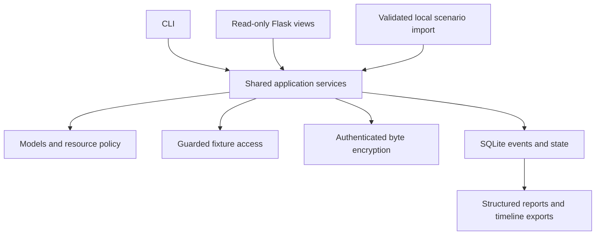
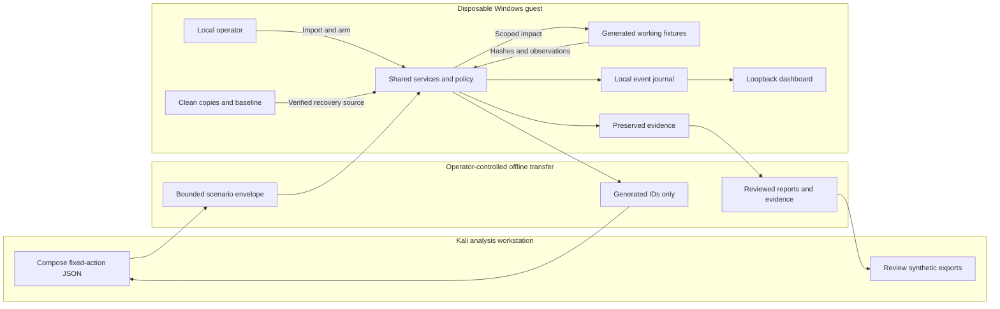

# System architecture

RansomLab is a modular Python application. The CLI and read-only Flask dashboard call the same services and use the same event and repository contracts. Kali exchanges bounded JSON documents with the Windows operator; there is no remote execution service or network receiver.

## Components

| Component | Responsibility |
| --- | --- |
| `core/config.py`, `core/errors.py` | Immutable resource limits and explicit validation/state/safety errors |
| `core/events.py`, `core/hashing.py` | Closed, versioned event records and bounded SHA-256 primitives |
| `core/repository.py` | Local SQLite authority; event/metadata transactions and conditional control-state updates |
| `storage.py` | Checked generated-object access, ancestor/alias checks and cross-process mutation leases |
| `crypto.py` | Byte-only AES-256-GCM provider adapter; Windows uses Microsoft CNG |
| `scenarios.py` | Bounded descriptors and fixed-action envelopes; strict schema, expiry and generation validation |
| `environment.py` | VMware guest indicator, non-elevated identity and operator attestation checks |
| `services.py` | Preparation, scenario execution, observations, alerts, containment, evidence, recovery and reporting |
| `cli.py`, `__main__.py` | Argument parsing, shared-service calls, structured results and exit codes |
| `dashboard.py`, `server.py`, templates/static assets | Authenticated loopback views and bounded HTTP handling without impact controls |



## Data flow and trust boundaries



The diagram specifies logical transfers, not a shared-folder or network configuration. Configure isolation, snapshots and the transfer procedure using the [VMware runbook](vmware-lab.md). Declared machine roles are not live network status.

## Managed storage

```text
<checkout>/.ransomlab/
  registry.key
  catalog.json
  lease.flag
  <generated-lab-id>/
    manifest.json
    state.db
    lease.flag
    work/
    clean/
    keys/
    evidence/<generated-evidence-id>/
```

The public CLI has no arbitrary root option. Fixture names derive from generated identifiers, and a local HMAC binds the manifest to registry key material. Only registered working objects are simulation targets. Recovery copies, keys, evidence and database files are separate from that inventory. A marker file or string-prefix check does not grant access.

Windows access currently requires local NTFS and retained ancestor/object handles. The Linux adapter uses descriptor-relative access with documented same-account race limitations. These are application and OS controls with specific assumptions, not a sandbox against a malicious administrator. See [filesystem details](implementation/filesystem-boundary.md).

## Lifecycle and durability

Preparation creates and verifies the fixture inventory. Arming is local, expiring and single-use. Import only stages a request; duplicate delivery cannot repeat consumed actions. One mutation lease coordinates simulation, observation updates, preservation and recovery. Containment can signal the active coordinator without taking that lease.

A committed operation intent precedes every working-fixture change; the result follows verification. SQLite and file changes are separate transactions, so an incomplete intent represents uncertainty until explicit reconciliation. Startup never resumes a simulation automatically. Existing SQLite sidecars trigger a stop for offline journal review.

Evidence attempts reserve storage durably before copying, including failed attempts. Recovery requires preserved evidence and verified clean sources. Success is based on the complete current baseline comparison, separately from historical recovery results. Missing fixture objects can produce partial evidence but are not recreated by the present recovery service.

## Events, reporting and interface limits

Event sequences order one lab journal. UTC timestamps aid presentation without claiming cross-machine causal order. Simulator actions, file observations and response actions have separate sources; incident and run identifiers link the records. SQLite remains authoritative; JSON, JSONL and Markdown are derivative outputs.

The dashboard binds to loopback and exchanges a private launch token for a signed local session. Host/origin checks, escaping, request limits and read-only application routes constrain browser access. It delegates all lab queries to shared services and exposes no host administration or file-impact controls.

Resource limits and selected providers are in [the dependency record](implementation/dependencies.md). Current test evidence and native-VM gaps are in [the validation report](implementation/validation-report.md) and [VM acceptance plan](implementation/vm-test-plan.md).
