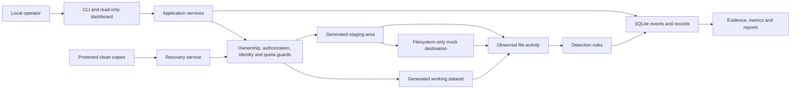

# Architecture specification

Architecture and implementation contracts. [README](../README.md) is the operating
entry point. The module extraction and advanced research records below remain the
target; the current foundation is described here.

## Implemented foundation

`core/config.py` loads bounded, closed TOML configuration into immutable AppConfig
and Policy records. `core/models.py` defines immutable ExperimentRecord lifecycle
metadata. `core/safety.py` checks signed manifest structure, inventory totals,
object aliases and policy compatibility before a database is opened. Existing
native SafeDirectory and LabLease controls remain the filesystem boundary.

The shared LabService now creates metadata-only drafts and explicitly validates,
inspects and closes experiments. The existing generated-data creation path uses
the same initialization routine. New lifecycle records and their events commit
atomically in the existing SQLite events/state schema. Old lab.created journals
remain readable without migration; an explicit validate/close operation writes
lifecycle metadata. Missing lifecycle data in a new journal fails closed.
The registry reserves one creation in creation.json before allocating a workspace.
An interrupted unregistered creation blocks further preparation for offline review;
it cannot silently accumulate uncounted workspaces or resume itself.

Draft, ready and closed are persisted metadata states; execution_state reports
the separate existing run/recovery state. Validation revokes unused arming but
does not authorize a run. Empty records cannot be armed. Every existing mutation
entry point rejects a closed experiment. For this foundation, closure requires an
intact baseline and preserved evidence for a completed run; closing with unresolved
damage remains unsupported. Closure never deletes data.

Structured stderr diagnostics emit validated events after SQLite commits, including
their durable sequence. SQLite remains authoritative. CLI and dashboard use the
same service/configuration factory. Packaging supplies the ransomlab entry point
and optional dashboard dependencies; source-checkout editable installation keeps
the managed root at `<checkout>/.ransomlab`.

## Architectural decisions

Use a modular Python application with one shared service layer, SQLite authority,
and thin CLI and Flask adapters. Retain `ransomlab` as the import/command name and
RansomLab as the repository name; Antech-RansomLab is the product name. Avoid a
framework rewrite, distributed workers, external brokers, React, or a separate
frontend build: these add complexity without helping one local research operator.

Preserve useful `Policy`, `Event`, `EventStore`, `SafeDirectory`, `LabLease`,
cryptographic vectors, and interface contracts. Incrementally extract the broad
`LabService` into cohesive services while retaining a compatibility facade.
Existing later-phase code is subject to its corresponding new phase's acceptance.

Choose standard-library dataclasses/enums, strict JSON validation, `argparse`,
`sqlite3`, `hashlib`, `logging`, `tomllib`, and `unittest`. Retain Flask/Jinja.
Recommend `cryptography` for portable research and Waitress for dedicated WSGI
serving in later phases; preserve current CNG/Uvicorn until tested replacements
are reviewed. Exact versions, artifacts, licenses, and advisories must be reviewed
at installation time. See [technology decisions](implementation/dependencies.md).

## Module boundaries

This is a proposed tree, not the current layout. Move one coherent capability
in its own phase rather than creating empty placeholder packages.

```text
ransomlab/
  core/          configuration, models, lifecycle, safety, errors, events
  storage/       guarded filesystem adapters, SQLite repositories, migrations
  crypto/        byte-only crypto, hashes, signatures, measurements
  simulation/    scenarios, synthetic generation, staging, local mock sink
  telemetry/     baseline snapshots, file observations, adapter health
  detection/     bounded rules, windows, correlation, alerts
  forensics/     evidence manifests, verification, investigation timelines
  recovery/      clean-copy custody, restoration, verification
  reporting/     evaluation, comparison, JSON/JSONL and Markdown
  services.py    compatibility facade and service composition
  cli.py         parsing and shared-service dispatch
  dashboard.py   read-only shared-service views
  server.py      authenticated bounded loopback serving
  templates/     server-rendered HTML
  static/        existing CSS/JavaScript, no build pipeline
scripts/         Python validation and Bash startup/preparation
tests/           unit, integration, boundary, failure and platform checks
```

| Interface | Contract and permitted access |
| --- | --- |
| ExperimentService | Create, validate, authorize, inspect and close; owns transactional transitions |
| ExperimentRepository / EventRepository | Versioned records, conditional updates, append-only application journal; no impact decisions |
| WorkspaceGuard | Scoped capabilities after ownership, identity, path and quota checks; no arbitrary target roots |
| ScenarioRunner | Fixed steps, generated IDs, admission checks and intent/results; work/staging/mock capabilities only |
| CryptoProvider | Bounded bytes in/out; no filesystem, URL, command or directory arguments |
| TelemetryService | Actual observations, identity and health; cannot infer success from simulator intent |
| DetectionService | Versioned rules over telemetry; alerts cite event IDs; no evaluator labels |
| EvidenceService | Approved artifact reads, bounded preservation and manifest verification |
| RecoveryService | Verified clean-source reads; restoration only to baseline names/identities through the guard |
| ReportService | Shared stored queries, provenance, evaluation and completeness; no illustrative results |

These are logical contracts, not newly implemented APIs. Explicit dependency
injection permits memory tests without a production bypass switch.

## Data and trust flow



The mock destination is a registered compartment under the same experiment,
accessed through an internal copy-and-receipt interface. It has no socket,
configurable URL, bind address, redirect, proxy, or upload handler. Observations
report actual bounded writes and receiver hash checks. These study local
staging/transfer patterns, not packet-level egress detection. Networking would
require a separately reviewed architecture change.

## Configuration and managed storage

Keep the default root fixed at `<checkout>/.ransomlab`. Configuration uses
closed versioned TOML: ceilings may only tighten, the free-space
floor may rise, and unsupported fields/types are rejected. No environment or CLI
override may redirect impact. Configuration is snapshotted and hashed into an
experiment. Approval names the canonical root and generation; dashboard access
grants no experiment authority.

```text
<checkout>/.ransomlab/
  registry.key, catalog.json, creation.json, lease.flag
  <generated-experiment-id>/
    manifest.json, state.db, lease.flag
    work/                         generated impact-eligible objects
    clean/                        no scenario write capability
    keys/                         per-run secrets, never exported
    staging/<generated-run-id>/    proposed generated copies
    mock/<generated-run-id>/       proposed local receipts and copies
    evidence/<generated-id>/       preserved synthetic artifacts
```

New compartments must be explicitly registered. Do not relax the existing rejection
of unexpected working objects to permit arbitrary notes, staging files, or renames.
Plan their names/IDs and budgets before authorization. Recovery, evidence, and
backup paths are never simulation targets. Startup and closure do not delete data.

The guard checks ancestors and final handles, rejects aliases/links, validates
regular-file ownership/identity, and enforces operation-time bounds. Normalization
alone is insufficient. Platform limits are in the [safety model](security.md) and
[existing adapter review](implementation/filesystem-boundary.md).

## Proposed data contracts

Records have strict fields/types, a schema version and bounded serialization.
IDs are canonical UUIDs, foreign records must match the experiment/generation,
and content digests are SHA-256. Labels are not paths. Use UTC plus monotonic
durations scoped to one process epoch; journal sequences establish local order.

| Record | Required fields beyond schema version | Invariants |
| --- | --- | --- |
| Experiment | ID, label, created/closed times, lifecycle state/revision, workspace identity, policy snapshot/hash, generator version/seed, baseline ID, source revision | Registered owner; conditional revisions; incomplete preparation cannot run |
| Dataset entry | Fixture ID, generation, generated relative name, class, canary flag, size, baseline digest, work/clean identities | Synthetic provenance, unique names/IDs, bounded total inventory |
| Authorization | ID, experiment/baseline IDs, scenario version/config hash, policy hash, issued/expiry times, operator assertions, consumed/revoked state | Single-use; finite lifetime; consumed atomically at admission; changed inputs invalidate |
| Run | ID, experiment ID, request/authorization IDs, scenario/config, state/revision, start/end, process epoch, intended/admitted/completed counts | One mutator; retries return prior results without repeating impact |
| Event | ID, experiment/run/object IDs, sequence, kind/source/severity/outcome, occurred/observed/recorded times, typed details | Distinguish simulator, observer, detector and response; no secrets or raw payloads |
| Observation | Event ID, sensor/version, operation, object identity, before/after size/hash, confidence, health/loss context | Actual observation; unsupported access/rename inference marked unknown |
| Alert | ID, rule/version/config hash, severity, input event IDs, correlation ID, detection time, disposition | Deduplicated and attributable; disposition does not overwrite observation |
| Evidence bundle | ID, run, source revision, capture time, event cutoff, manifest digest, artifact entries, completeness/failures | Hashes/sizes and generated names; no keys; missing artifacts explicit |
| Recovery attempt | ID, baseline/evidence IDs, mode, per-file outcomes, start/end, verified/missing/corrupt counts | Current full-inventory verification independent of historical success |
| Evaluation/report | ID, runs, rule/scenario versions, unit/window, labels, TP/FP/FN/TN, unavailable reasons, coverage/recovery | Labels isolated from detector inputs; denominators and missing evidence retained |

The existing v1 Event uses `lab_id`, `created_at`, and a smaller source/kind
vocabulary; manifests and run metadata are dictionaries. Preserve v1 records
through explicit legacy adapters. Do not silently reinterpret IDs or overwrite
stored v1 JSON with new fields.

## Lifecycle and interruption semantics

Separate experiment lifecycle, execution outcome and recovery state. Alerts are
findings, not lifecycle states. Proposed experiment transitions:

| From | To | Admission requirement |
| --- | --- | --- |
| Absent | Draft | Create only new owned metadata/workspace; register after durable initialization |
| Draft | Ready | Validate ownership, policy, schema and required artifacts; once a dataset exists, verify baseline and clean copies |
| Ready | Authorized | Operator consent binds scenario, inventory, policy and finite budget |
| Authorized | Ready | Expiry, cancellation or changed input revokes unused authority |
| Authorized | Running | Revalidate all gates, acquire lease, atomically consume authority and record start |
| Running | Review required | Completed, contained, failed or interrupted outcome; retain pending intents |
| Review required | Ready | Reconcile uncertainty, preserve evidence and verify clean baseline before another run |
| Draft / Ready / Review required | Closed | No active worker/pending intent; revoke authority, preserve available evidence and record closure outcome |

The current foundation implements metadata creation/validation/inspection/closure
alongside the existing execution services. Empty drafts may close without datasets.
Closure currently requires an intact baseline, reconciliation of uncertain work,
and preserved evidence for completed runs. Allowing closure with unresolved damage
is a future extension of the proposed lifecycle, not an available operation.
Closed experiments are read-only; repeat research in a new experiment.

Run outcomes are completed, contained, failed or interrupted. Recovery attempts
are pending, running, verified, partial or failed. Later observations can invalidate
current verification without rewriting history. Existing prepared, armed,
reconciliation_required, recovering and verification_lost results remain execution
states alongside the typed experiment lifecycle; inspect exposes both explicitly.

Commit an intent before each file change, then observe/verify bytes and commit a
result. SQLite and filesystem changes are not atomic together. A missing result
means uncertainty, never success or automatic retry. Restart with stale active
records/pending intents requires reconciliation. Do not steal a possibly live
lease, delete journals, or resume impact. Cancellation stops admission and is
checked between bounded operations; kernel I/O has no hard real-time guarantee.

## Persistence and concurrency

Keep one SQLite database per experiment and the bounded registry. Existing
events/state tables, sequence index, unique IDs, full synchronization, rollback
journal, conditional updates and read-only connections remain the base. Add typed
serialization/repositories and schema tests before normalizing more tables.
Parameterize data queries and bound result pages, JSON depth, pages and retry time.

Persist state and its event in one transaction. A mutation lease coordinates work,
observation writes, evidence and recovery; containment uses a short conditional
transaction without waiting for that lease. Reads never create missing stores.
Retain SQLite sidecar rejection until native crash/sidecar safety is demonstrated.
Do not enable WAL or automatic recovery as an unreviewed workaround.

Unknown schemas fail closed. Migrations must be explicit, offline, backed up and
verified, with no active experiments; failures retain a readable prior copy.
Phase 0 migrates nothing. Runtime records and exports stay out of Git.

## Telemetry, metrics and reproducibility

Use independent snapshots for content integrity and scoped adapter observations
for reads/staging/mock writes. Native notifications may accelerate polling later,
but record dropped events and health. Polling does not detect reads or reliably
see transient create/delete operations. Rename attribution requires a matching
registered identity; otherwise report missing/new or unknown. Simulator labels
belong to evaluation and must not become detector features.

Default evaluation unit: one run/stage and one predeclared rule-family window.
Match at most one deduplicated alert per eligible positive unit, counted as TP. Negative units
with alerts are FP; positive units without a match are FN; silent negative units
are TN. Persist matching policy and grace interval before execution. Preempted
actions are prevention outcomes, not FN. Incomplete observation windows are
unscorable and reduce coverage; never silently count them TN.
Report alerts outside declared windows as unmatched rather than dropping them.

Precision = TP/(TP+FP); recall = TP/(TP+FN); false-positive rate = FP/(FP+TN);
F1 = 2TP/(2TP+FP+FN). Zero denominators yield null with a reason. Measure detection
delay from the first qualifying observation to the first alert in one monotonic
epoch; report action-to-observation delay separately when available. Missing
detections and cross-restart uncertainty stay explicit. Retain sample counts,
per-run values and supported median/p95 summaries.

Recovery success = baseline files with verified restored hashes / all baseline
files; missing/corrupt files remain in the denominator. Report bytes verified,
duration, failures and current versus historical verification separately.
Staged/mock-received bytes are measured local synthetic exposure. Comparisons
require compatible scenario, generator, policy, rule and evaluation versions;
otherwise report incomparable results.

Store generator version/seed, synthetic class mix, action order/pacing, config and
policy hashes, source revision, provider/runtime/platform versions and observer
settings. Replay deterministic content/actions in a new experiment. UUIDs, times,
fresh keys and nonces are intentionally nondeterministic; never seed operational
crypto for identical ciphertext. Compare baselines/normalized actions and declared
timing tolerances rather than exact encrypted bytes or wall clocks.

## Interface and startup contract

Keep argparse and stable structured errors. Flask reads the same services with
token/session authentication, loopback binding, Host/Origin validation, escaping
and request/query bounds. No mutation, remote-worker or upload endpoint is needed.
Display unavailable metrics honestly. Machine inventory is declared, not probed.

Phase 8's Bash wrapper will call shared Python preflight services, validate
configuration/resources, prepare approved metadata, start the selected interface
and forward shutdown signals. It must never auto-arm/run, install dependencies,
or clean unrelated paths. PowerShell is limited to Windows-specific diagnostics
or encoding needs. VMware home-lab configuration remains Phase 11 work.
